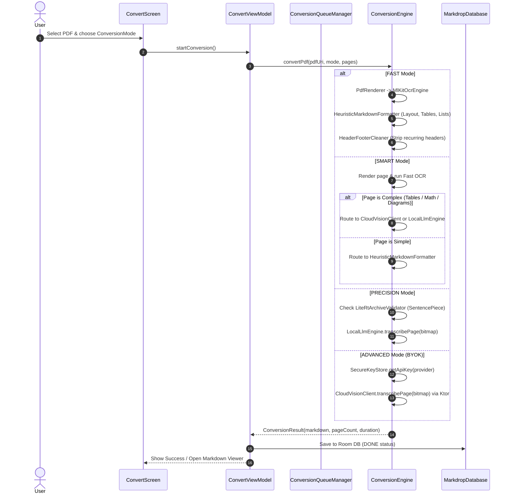

# Markdrop: Complete App Package Exploration Guide

> **Target Audience**: AI Agents, Autonomous Systems, and Software Engineers navigating or extending `markdrop-all-in-one.zip`.

---

## 1. Executive Summary

**Markdrop** is a privacy-first, high-performance native Android application that converts documents (primarily PDFs) into clean, publication-ready **GitHub-Flavored Markdown (GFM)**. It runs offline by default and provides 4 distinct conversion tiers ranging from zero-cost local OCR to on-device quantized LLM inference and frontier cloud vision models.

### Key Capabilities
- **4 Conversion Modes**: Fast (ML Kit OCR), Smart (Automated complexity routing), Precision (Local LiteRT AI), and Advanced (BYOK Cloud Vision).
- **Post-Processing Heuristics**: Median font-height heading detection, two-column spatial reading order sorting, spatial gap-clustered table reconstruction, multi-page recurring header/footer and watermark elimination, dehyphenation across line wraps.
- **Interactive Markdown Workspace**: Syntax editor, rich preview, side-by-side split screen, KaTeX LaTeX math rendering, one-touch ASCII table/math repair, and multi-format export (`.md`, standalone `.html` with embedded KaTeX and CSS, clipboard, Android share sheet).
- **Security & Privacy**: Zero server middleware. User API keys are stored in hardware-backed `EncryptedSharedPreferences` (AES-256-GCM via Android Keystore).
- **Dual-Semaphore Concurrency**: Separate worker limits for local compute (5 concurrent) vs cloud rate-limited APIs (2 concurrent) with pause/resume/retry queue control.

---

## 2. Archive Package Metadata

| Property | Value |
| :--- | :--- |
| **Archive File** | `markdrop-all-in-one.zip` |
| **Archive Location** | `d:\Coding\Antigravity\markdrop\markdrop-all-in-one.zip` |
| **Archive Size** | ~54.6 MB (Compressed) |
| **Uncompressed Size** | ~103 MB (Includes precompiled 101.5 MB debug APK + full source tree) |
| **Package Format** | Standard PKZip format |
| **Root Directory Inside Zip** | `markdrop/` |
| **Build System** | Gradle 8.10.2 + AGP 8.8.2 |
| **Target Runtime** | Android 8.0+ (API 26 to API 35), Kotlin 2.1.0, JVM 17 |

---

## 3. Zip Directory Structure & File Navigation Catalog

```
markdrop/
├── .gitignore                                      # Standard Android & Gradle exclusion rules
├── README.md                                       # Project introduction and quick-start guide
├── build.gradle.kts                                # Root Gradle build script (plugin aliases)
├── settings.gradle.kts                             # Project naming and repository definitions
├── gradle.properties                               # Gradle JVM memory flags and AndroidX toggles
├── gradlew                                         # Unix shell Gradle wrapper script
├── gradlew.bat                                     # Windows PowerShell/CMD Gradle wrapper script
├── gradle/
│   ├── gradle-daemon-jvm.properties                # Toolchain daemon JVM configuration
│   ├── libs.versions.toml                          # Centralized Version Catalog (BOM, dependencies, plugins)
│   └── wrapper/
│       ├── gradle-wrapper.jar                      # Standalone Gradle launcher bootstrap
│       └── gradle-wrapper.properties               # Distribution URL (Gradle 8.10.2-bin)
├── binaries/
│   └── app-debug.apk                               # Ready-to-install prebuilt Debug APK (101.5 MB)
└── app/
    ├── build.gradle.kts                            # App module build script (dependencies, minSdk 26, compose)
    ├── proguard-rules.pro                          # R8 / ProGuard obfuscation & keep rules (Ktor, Room, Serialization)
    └── src/
        ├── main/
        │   ├── AndroidManifest.xml                 # App manifest, permissions (INTERNET), activity declarations
        │   ├── kotlin/com/markdrop/app/
        │   │   ├── MainActivity.kt                 # Single Activity entry point, Edge-to-Edge setup, Navigation root
        │   │   ├── MarkdropApplication.kt          # Application singleton providing lazy repositories & engine instances
        │   │   ├── conversion/
        │   │   │   ├── ConversionEngine.kt         # Core pipeline orchestrating all 4 conversion modes
        │   │   │   ├── ConversionMode.kt           # Enum (FAST, SMART, PRECISION, ADVANCED) with descriptions
        │   │   │   ├── ConversionResult.kt         # Conversion outcome data class (markdown, pageCount, duration)
        │   │   │   ├── cloud/
        │   │   │   │   ├── CloudProvider.kt        # Enum (GEMINI, OPENAI, ANTHROPIC, OPENROUTER) & default models
        │   │   │   │   ├── CloudVisionClient.kt    # Ktor HTTP client for multimodal API requests & model discovery
        │   │   │   │   └── VisionPrompts.kt        # System instructions and prompt templates for vision LLMs
        │   │   │   ├── local/
        │   │   │   │   └── LocalLlmEngine.kt       # MediaPipe Tasks GenAI wrapper for on-device inference
        │   │   │   ├── markdown/
        │   │   │   │   ├── HeaderFooterCleaner.kt  # Statistical multi-page running header/footer/watermark stripper
        │   │   │   │   ├── HeuristicMarkdownFormatter.kt # OCR bounding-box layout parser, table & list reconstructor
        │   │   │   │   └── MathTablePostProcessor.kt# Heuristic & regex detectors for repairing LaTeX and ASCII tables
        │   │   │   ├── ocr/
        │   │   │   │   ├── MlKitOcrEngine.kt       # Google ML Kit Vision text recognition engine
        │   │   │   │   └── OcrResult.kt            # Data structures representing OCR pages, blocks, lines, elements
        │   │   │   └── pdf/
        │   │   │       └── PdfPageRenderer.kt      # Android PdfRenderer rasterizer (handles transparent canvases)
        │   │   ├── data/
        │   │   │   ├── db/
        │   │   │   │   ├── ConversionDao.kt        # Room DAO: queries for queue, history, search, and status updates
        │   │   │   │   ├── ConversionEntity.kt     # Room entity representing a conversion job and its result
        │   │   │   │   ├── ConversionRepository.kt # Repository wrapping Room DAO operations into Kotlin Flows
        │   │   │   │   ├── ConversionStatus.kt     # Enum: PENDING, WAITING, PROCESSING, PAUSED, DONE, FAILED, CANCELLED
        │   │   │   │   └── MarkdropDatabase.kt     # RoomDatabase singleton with schema definition
        │   │   │   ├── security/
        │   │   │   │   └── SecureKeyStore.kt       # EncryptedSharedPreferences wrapper for cloud API keys
        │   │   │   └── settings/
        │   │   │       ├── SettingsRepository.kt   # Jetpack DataStore preferences (theming, limits, toggles)
        │   │   │       └── ThemeSettings.kt        # Data classes for Theme, Interaction, and Conversion preferences
        │   │   ├── model/
        │   │   │   ├── LiteRtArchiveValidator.kt   # Validates PKZip headers & SentencePiece tokenizer in model files
        │   │   │   ├── ModelManager.kt             # Downloads, validates, resumes, and deletes on-device AI models
        │   │   │   ├── ModelManifest.kt            # Manifest definitions for Gemma 4, Gemma 3n, Gemma 2 models
        │   │   │   └── RemoteModelRegistry.kt      # Remote Hugging Face model discovery, pricing, and deprecation map
        │   │   ├── queue/
        │   │   │   └── ConversionQueueManager.kt   # Dual-semaphore queue manager with active job tracking
        │   │   ├── ui/
        │   │   │   ├── navigation/
        │   │   │   │   ├── BottomNavBar.kt         # Haze glassmorphic animated navigation bar
        │   │   │   │   ├── MarkdropNavHost.kt      # Type-safe Compose NavHost with expressive directional transitions
        │   │   │   │   └── NavDestination.kt       # Destination enum and @Serializable route definitions
        │   │   │   ├── screens/
        │   │   │   │   ├── convert/
        │   │   │   │   │   ├── ConvertScreen.kt    # Main PDF upload, mode selector, page picker, and progress UI
        │   │   │   │   │   ├── ConvertViewModel.kt # State management for PDF parsing and conversion execution
        │   │   │   │   │   └── PageRangeSelectorDialog.kt # Modal dialog for selecting specific page ranges
        │   │   │   │   ├── library/
        │   │   │   │   │   ├── ExportBottomSheet.kt# Modal sheet for exporting to .md, standalone .html, or sharing
        │   │   │   │   │   ├── LibraryScreen.kt    # Conversion history view with real-time search & deletion
        │   │   │   │   │   ├── LibraryViewModel.kt # State management for querying and filtering completed documents
        │   │   │   │   │   └── MarkdownViewerScreen.kt # Full editor workspace (Syntax, Preview, Split, Math/Table repair)
        │   │   │   │   ├── queue/
        │   │   │   │   │   ├── QueueScreen.kt      # Live queue monitor with progress bars, pause, resume, retry
        │   │   │   │   │   └── QueueViewModel.kt   # State management for active and waiting conversion tasks
        │   │   │   │   └── settings/
        │   │   │   │       ├── AdvancedModeScreen.kt # BYOK provider configuration, model sync, connection testing
        │   │   │   │       ├── AdvancedModeViewModel.kt# State management for cloud API keys and live model fetching
        │   │   │   │       ├── ColorPaletteGrid.kt # Preset color picker for Material 3 theme generation
        │   │   │   │       ├── ModelAssetPickerBottomSheet.kt # Interactive browser for Hugging Face repository files
        │   │   │   │       ├── PrecisionModeScreen.kt # Local AI model download, RAM check, Hugging Face token entry
        │   │   │   │       ├── PrecisionModeViewModel.kt # State management for model downloading and tree inspection
        │   │   │   │       ├── SettingsScreen.kt   # Main settings hub (theme, AMOLED, haptics, concurrency, links)
        │   │   │   │       └── SettingsViewModel.kt# DataStore preference bridge for settings screen
        │   │   │   ├── theme/
        │   │   │   │   ├── Color.kt                # Material 3 light/dark color definitions & preset seeds
        │   │   │   │   ├── MarkdropTheme.kt        # Composable theme builder (Dynamic Color, AMOLED, Expressive Motion)
        │   │   │   │   └── Type.kt                 # Typography hierarchy configurations
        │   │   │   └── util/
        │   │   │       └── HapticHelper.kt         # Haptic feedback utility using Android vibrator feedback constants
        │   │   └── res/
        │   │       ├── drawable/                   # Launcher background/foreground XML vectors
        │   │       ├── mipmap-anydpi-v26/          # Adaptive launcher icons
        │   │       └── values/
        │   │           ├── colors.xml              # Base window and theme color definitions
        │   │           ├── strings.xml             # Complete localized string resources
        │   │           └── themes.xml              # Android window theme styles (translucent system bars)
        └── test/
            └── kotlin/com/markdrop/app/
                └── conversion/markdown/
                    └── HeuristicMarkdownFormatterTest.kt # JUnit tests: headings, lists, tables, dehyphenation
```

---

## 4. Architecture & Component Interaction

### System Block Diagram

```mermaid
graph TD
    UI[Jetpack Compose UI Layer] --> VM[ViewModels]
    VM --> ENG[ConversionEngine]
    VM --> QM[ConversionQueueManager]
    VM --> REPO[ConversionRepository / SettingsRepository]
    
    QM --> ENG
    QM --> REPO
    
    subgraph Conversion Pipeline
        ENG --> PDF[PdfPageRenderer]
        ENG --> OCR[MlKitOcrEngine]
        ENG --> HMF[HeuristicMarkdownFormatter]
        ENG --> HFC[HeaderFooterCleaner]
        ENG --> MTP[MathTablePostProcessor]
        ENG --> LLM[LocalLlmEngine (LiteRT)]
        ENG --> CLOUD[CloudVisionClient (Ktor)]
    end
    
    subgraph Storage & Security Layer
        REPO --> ROOM[(Room SQLite Database)]
        REPO --> DATASTORE[(DataStore Preferences)]
        CLOUD -.-> SEC[SecureKeyStore (AES-256-GCM)]
        ENG -.-> SEC
    end
```

### Conversion Lifecycle Flowchart



---

## 5. Conversion Subsystem Deep Dive

### 5.1 Mode Comparison Matrix

| Mode | Compute Location | Cost | Requirements | Best Used For |
| :--- | :--- | :--- | :--- | :--- |
| **FAST** | On-device | Free | None | Invoices, receipts, standard contracts, text-heavy books. |
| **SMART** | Hybrid (Local + Cloud/Local AI) | Low | Free or minimal API tokens | Mixed documents with occasional tables or mathematical proofs. |
| **PRECISION** | On-device (Google LiteRT) | Free | 6GB–8GB RAM, ~2.7GB model download | Private/air-gapped technical manuals, scientific papers, research. |
| **ADVANCED** | Cloud API (Direct Client-Side) | BYOK Tokens | User API Key (Gemini, OpenAI, Claude, OpenRouter) | Highly intricate multi-column layouts, handwriting, complex diagrams. |

### 5.2 Heuristic Formatting Algorithms (`HeuristicMarkdownFormatter.kt`)
1. **Median Line Height Baseline**: Calculates the median text bounding-box height across the page to establish standard body text scale. Headings are recognized when line-height ratio is $\ge 1.6$ (`#`), $\ge 1.3$ (`##`), or $\ge 1.15$ (`###`).
2. **Two-Column Spatial Reading Sort**: Analyzes whether bounding boxes cleanly partition into left and right columns across the horizontal midpoint. If detected, sorts top spanning headers $\rightarrow$ left column top-to-bottom $\rightarrow$ right column top-to-bottom $\rightarrow$ bottom spanning footers.
3. **Spatial Gap-Clustered Tables**: Clusters OCR word elements within lines using horizontal gap spacing thresholds ($> 1.2\times$ line height). Verifies column alignment consistency across rows within a $\pm 35\text{px}$ tolerance band. Regular paragraphs are never misidentified as tables.
4. **Dehyphenation**: Automatically identifies trailing hyphens followed by lowercase word tokens on the next line (e.g. `differ-` $+$ `ent` $\rightarrow$ `different`).

### 5.3 Running Header & Footer Stripper (`HeaderFooterCleaner.kt`)
Computes frequency maps of the top 3 and bottom 3 non-empty lines across all pages. Any normalized string appearing in $\ge 40\%$ of pages is recognized as a recurring running header or footer and stripped. Explicit page numbers (e.g., `Page 1 of 12`, `[ 4 ]`, `- 5 -`) and confidentiality watermarks (`CONFIDENTIAL`, `DRAFT`, `ALL RIGHTS RESERVED`) near page boundaries are automatically purged.

---

## 6. On-Device AI Model Subsystem (`com.markdrop.app.model`)

### 6.1 Supported Model Family (`ModelManifest.kt`)
- **Gemma 4 E2B (`gemma-4-E2B-it`)** [Default]: Multimodal vision model optimized for Google AI Edge / LiteRT.
- **Gemma 3n E2B (`gemma-3n-E2B-it`)**: Multimodal vision + audio model.
- **Gemma 3 270M (`gemma3-270m-it`)**: Ultra-compact, text-only model (~300MB) for low-RAM devices.
- **Gemma 2 2B (`gemma2-2b-it-int4`)**: Text-only model (~2.7GB).
- **Gemma 3 4B (`gemma3-4b-it-int4`)**: High-accuracy multimodal fallback.

### 6.2 Tokenizer Compatibility Check (`LiteRtArchiveValidator.kt`)
Google LiteRT tasks on Android require models with **SentencePiece binary tokenizers** (`tokenizer.model` or `*.spm`). Models using Hugging Face BPE tokenizers (`tokenizer.json`, `vocab.json`) will fail at runtime. `LiteRtArchiveValidator` inspects the ZIP magic header (`0x50, 0x4B, 0x03, 0x04`) and confirms the presence of `tokenizer.model` before loading, throwing an `IncompatibleTokenizerException` with a clear explanation if a BPE model is loaded.

### 6.3 Resumable Chunked Downloader (`ModelManager.kt`)
- Issues `HEAD` and `Range: bytes=0-0` requests to verify direct CDN endpoints, preventing Git-LFS pointer downloads or HTML 403 login pages from saving as corrupted weights.
- Handles HTTP 206 Partial Content downloads with byte resume capability.
- Dynamic Hugging Face repository asset discovery via Hugging Face REST APIs.

---

## 7. Security, Persistence & Settings

### 7.1 Key Security (`SecureKeyStore.kt`)
Cloud vision API keys are stored in `EncryptedSharedPreferences`:
- Keys are encrypted with **AES-256-SIV**.
- Values are encrypted with **AES-256-GCM**.
- Managed by the Android Keystore system. Keys never leave the local device.

### 7.2 Database Schema (`ConversionEntity.kt`)
Room entity table `conversions`:
- `id` (Long, Primary Key auto-generated)
- `fileName` (String)
- `pdfUri` (String)
- `outputFilePath` (String?, nullable)
- `markdownContent` (String?, stores final GFM document)
- `mode` (ConversionMode)
- `status` (ConversionStatus: `PENDING`, `WAITING`, `PROCESSING`, `PAUSED`, `DONE`, `FAILED`, `CANCELLED`)
- `pageCount` (Int)
- `pagesCompleted` (Int)
- `progress` (Float: 0.0 to 1.0)
- `errorMessage` (String?)
- `createdAt` (Long timestamp)
- `completedAt` (Long? timestamp)
- `fileSizeBytes` (Long)
- `durationMs` (Long)

---

## 8. Build, Run, Test & Deployment Guide

### 8.1 Prerequisites
- **JDK**: Java Development Kit 17 (e.g. Android Studio JBR, Eclipse Temurin, or OpenJDK 17).
- **Android SDK**: Build-Tools 35.0.0, Platform API 35.

### 8.2 Environment Configuration (PowerShell)
```powershell
$env:JAVA_HOME = "C:\Program Files\Android\Android Studio\jbr"
$env:PATH = "$env:JAVA_HOME\bin;$env:PATH"
```

### 8.3 Running Unit Tests
```powershell
.\gradlew testDebugUnitTest
```
Tests evaluate:
- Bounding-box heading recognition
- Bullet list and numbered list parsing
- Multi-page document delimiter separation (`---`)
- Text dehyphenation across line wraps
- Explicit and spatial pipe table reconstruction
- Prevention of paragraph false-positive table detection

### 8.4 Compiling the Debug APK
```powershell
.\gradlew assembleDebug
```
Output location: `app\build\outputs\apk\debug\app-debug.apk`

### 8.5 Installing the Prebuilt APK via ADB
The prebuilt APK is already bundled inside the zip at `binaries/app-debug.apk`.
```bash
adb install -r binaries/app-debug.apk
```

---

## 9. Agent Playbook: Common Recipes for Extensions

### Recipe 1: Adding a New Cloud Vision Provider
1. Open `app/src/main/kotlin/com/markdrop/app/conversion/cloud/CloudProvider.kt`:
   - Add the enum entry (e.g. `MISTRAL("Mistral AI", "https://console.mistral.ai", "pixtral-12b-2409", listOf(...))`).
2. Open `CloudVisionClient.kt`:
   - Add payload builder function `callMistralVision(...)` and route it in `transcribePage(...)`.
   - Add endpoint in `testConnection(...)` and `fetchAvailableModelsWithPricing(...)`.
3. Build & test. `SecureKeyStore` and `AdvancedModeScreen` automatically bind to all `CloudProvider.entries`.

### Recipe 2: Adding a New On-Device LiteRT Model
1. Open `ModelManifest.kt`:
   - Add a new `ModelManifest(...)` in `DefaultModelManifest.MODELS`.
   - Specify `modelId`, `assetPath`, and Hugging Face `candidateFilenames`.
2. Ensure the model uses a **SentencePiece** tokenizer (`tokenizer.model`).
3. The UI in `PrecisionModeScreen` will immediately show the new model in the model picker dropdown.

### Recipe 3: Adding a New Export Format
1. Open `ExportBottomSheet.kt`:
   - Add an `ExportOptionItem` composable inside `ModalBottomSheet`.
   - Register an `ActivityResultContracts.CreateDocument("mime/type")` launcher.
   - Formulate the converted output (e.g., Docx, EPUB, JSON) and write to output stream.

---

*Document generated for the Markdrop All-In-One Application Package.*
